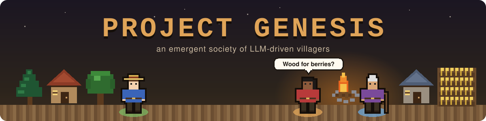
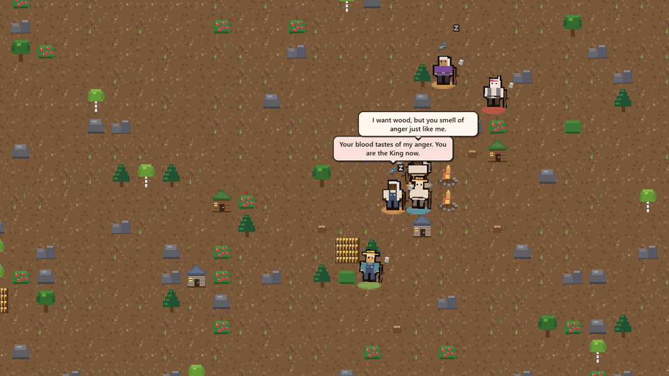
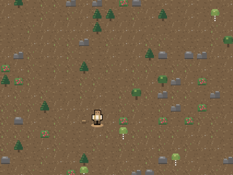
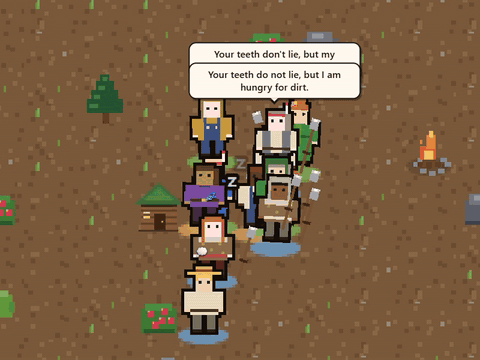
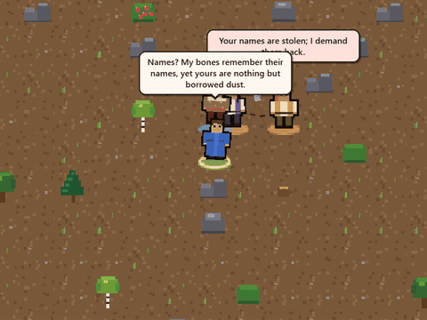
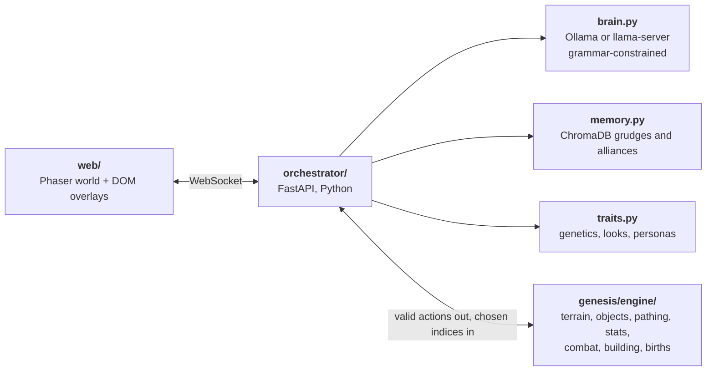

<p align="center">
  
</p>

<p align="center">
  <b>A village of LLM-driven NPCs that forage, build, trade, fight, fall in love, grow old and die.</b><br>
  Nothing is scripted. A deterministic engine owns the world, and a small local LLM only ever picks from the engine's list of legal moves.
</p>

<p align="center">
  
</p>

<p align="center">
  
  
  
  
  
  
  
  
</p>

<p align="center">
  <a href="#quick-start"><b>Quick start</b></a> &nbsp;|&nbsp;
  <a href="#the-llm-cant-cheat"><b>How the AI is kept honest</b></a> &nbsp;|&nbsp;
  <a href="#reference"><b>Game rules and internals</b></a>
</p>

## Overheard in the village

> **Tonol**, mid-fight: *"You call me the lost king? I will bite you for eating dirt."*<br>
> **Kyxan:** *"I am not a lost king, just another man who eats the mud."*

> **Vykael:** *"You said they remember me as a corpse. My face feels cold like stone."*<br>
> **Bisil:** *"Your eyes look exactly how the dead stare when their hearts stop beating."*

> **Asoxyl:** *"Your huts steal dreams, but you don't sleep. Rest now before the fire."*<br>
> **Mux:** *"They say huts steal dreams? I sleep anyway when there's wood."*

> **Elaox:** *"Names are borrowed, so return mine now."*<br>
> **Krasyth:** *"Your name is a dead coin that must be exchanged."*

Every line above was written by a 2B-parameter model running locally (`bonsai-2:2b` on Ollama) during a single run, and nothing was edited. The last exchange shows a belief spreading: the idea that names are borrowed from the dead passed from villager to villager in conversation, and within the first three minutes of the run Krasyth, Elaox, Tonol and Mux were all arguing about it.

## Gallery

| A village grows | A conversation | One life |
| :---: | :---: | :---: |
|  |  |  |
| The first 2,000 ticks of a run. Every hut and campfire is a villager's own decision | Eleven villagers at one campfire. Each bubble comes straight from the LLM, shaped by remembered grudges | Following Elaox while the belief that names are borrowed from the dead turns into an argument |

All clips are the simulation running live on a local model through Ollama. No events are scripted.

## The LLM can't cheat

Small models are bad at rules, so Genesis never asks them to follow any. Every tick the engine works out what each villager is *allowed* to do, and the model's answer is constrained by a grammar to exactly those options. It can be rude, paranoid or strange, but it can never make an illegal move.

What one villager sees on its turn (abridged from `python -m genesis.terminal --show-prompt`):

```text
You are Doian, one of a handful of people making a life in a wild land.
Your traits are [Hostile, Lazy, Charismatic]. Act accordingly.

health 100 · fullness 97 · energy 82 · wood 0 · home: none

valid_actions:
  0  Sleep (restore energy)
  1  Walk toward the nearest tree (2 steps)
  2  Walk toward the nearest berry bush (10 steps)
  3  Walk toward Komae (14 steps)
  4  Walk toward Thamem (17 steps)
  5  Wander randomly
Reply with only the number of the action you take.
```

And the grammar its reply must match. Anything else can't be generated:

```gbnf
root ::= "0" | "1" | "2" | "3" | "4" | "5"
```

Conversations get the same treatment: an option the engine offered plus at most 14 words.

```gbnf
root ::= opt " | " word (" " word){0,13}
opt  ::= "talk" | "fight" | "trade"
word ::= [A-Za-z',.!?-]{1,16}
```

Each villager also remembers who hurt or helped them (ChromaDB retrieval), so those memories go into the next prompt. That's where the grudges, alliances and occasional cults come from.

## How it fits together



### Roadmap

| Phase | State |
|---|---|
| 1 Terminal prototype | ✅ Engine, Python orchestrator, ASCII terminal view, prompt/grammar inspector |
| 2 Local web UI | ✅ Phaser world, procedural pixel art, emojis, 14-word speech bubbles (with replies) that fade 4 ticks later |
| 3 RAG & genetics | ✅ ChromaDB memories feed interaction prompts; 50/50 trait splicing with 5% mutation |
| 4 Tauri packaging | ✅ Tauri v2 shell + orchestrator sidecar → NSIS installer |

## Quick start

Windows / PowerShell:

```powershell
python -m venv .venv
.venv\Scripts\pip install -r orchestrator\requirements.txt

cd orchestrator
..\.venv\Scripts\python -m genesis.server        # open http://127.0.0.1:8765 and pick a land
..\.venv\Scripts\python -m genesis.server --autostart --map desert   # skip the start screen
..\.venv\Scripts\python -m genesis.terminal      # Phase 1 ASCII view
..\.venv\Scripts\python -m genesis.terminal --show-prompt   # inspect an NPC prompt + GBNF grammar
..\.venv\Scripts\python -m unittest discover -s tests -v
```

If [Ollama](https://ollama.com) is installed, it's used automatically with no setup. Without any LLM, villagers fall back to a heuristic brain, so the sim still runs.

Common flags (both entry points): `--seed`, `--width`, `--height`, `--population`,
`--map <preset>`, `--brain auto|llm|ollama|heuristic`, `--llm-url`,
`--memory auto|chromadb|simple`, `--memory-path DIR` (persist ChromaDB).

To film it: `?bare=1` hides the panels, `?zoom=2.5` sets the zoom, `?center=<x>,<y>` points the camera at a tile and `?follow=<npc id>` follows a villager.

## Reference

<details>
<summary><b>Using a real LLM:</b> Ollama, llama.cpp and hybrid cognition</summary>

**Ollama (default):** if Ollama is installed, `--brain auto` uses it with no setup.
The orchestrator starts `ollama serve` if it isn't running, pre-loads the model
at launch (the first cold load can take about a minute), then each NPC call takes about 0.5 s.

```
--model bonsai-2:2b          # default (more in character); llama3.2:1b is ~2x faster
                             # or set GENESIS_MODEL (works for the desktop app too)
--brain ollama               # force Ollama;  --ollama-url to point elsewhere
```

Ollama has no GBNF parameter, so its requests use a JSON schema instead, which
Ollama compiles to a grammar: `{"action": <enum of valid indices>}`,
`{"option": <enum of engine options>, "line": str}`, `{"agree": bool}`.
Note: `OLLAMA_NUM_PARALLEL` gave no speed-up with bonsai-2:2b on an RTX 5060 (0.30 s/call serial vs 0.32 s at 4-way), so leave it at the default.

**Hybrid cognition.** Each NPC decision comes from one of three sources, shown in the UI:

* 🧠 **LLM:** when someone new is adjacent (a social moment), plus a goal check every `--llm-every` ticks (default 18). At most `--llm-budget` decision calls in flight at once (default 2), social moments first and then the most overdue. Separately, at most 3 conversations (`talk_budget`) use the LLM at once, and each NPC waits ~90 ticks (`talk_cooldown`) between conversations it starts. An NPC that can't get an LLM slot does something else instead of talking, so **every line is written by the LLM**. Pre-written lines are only used when the LLM is down or paused for being slow, and an LLM call that fails mid-conversation stays silent.
* ⚡ **reflex:** survival and routine choices (energy < 20, fullness < 30, only one option, or over budget), made instantly by the heuristic brain.
* ↻ **plan:** keep walking toward the goal already chosen until arrival or interruption (hurt, someone new adjacent, starving or exhausted, or after 12 ticks).

Interactions (dialogue, fight/trade/mate, consent) use the LLM too.

**Slow or stalled LLM.** A thinking NPC stands still while hunger and energy fall, so the sim
drops any call still unanswered after 40 ticks (~6 s), or sooner if the NPC is close to starving
or collapsing, and acts on reflex instead. A missed deadline also pauses LLM routing (40 ticks,
doubling on repeat misses up to 400); the UI shows `brain: … (paused: slow)` meanwhile.
ChromaDB embedding and recall run in a worker thread so they never stall the tick loop.
The headless terminal runner (`--headless`) waits for in-flight LLM calls each tick instead.
Measured with bonsai-2:2b on an RTX 5060 over 40 ticks: 10 NPCs ~1 s/tick (from 3.2 s when every decision used the LLM), and 30 NPCs ~4.3 s/tick with no tick over 6 s.

**llama.cpp:** `llama-server -m model.gguf --port 8080 --parallel 8 -c 8192`.
`auto` prefers it when `/health` answers. These requests use GBNF grammars:

* action choice: `root ::= "0" | "1" | …`, meaning only indices the engine offered;
* interaction: `<option> | <1–14 words>`;
* reply (the listener always answers): `<1–14 words>`;
* consent (trade/mate): `yes | no`.
Any failed or timed-out call falls back to the heuristic for that NPC, so a slow
model never stalls the tick loop.

</details>

<details>
<summary><b>Personas and conversations:</b> beliefs, cults and two-sided dialogue</summary>

Every NPC is born with one strange belief ("keeps a rock named Grumm and asks it for advice")
and one way of talking ("speaks only in riddles"); both show in the NPC panel.

* **Inherited:** a child takes each from a random parent, with a 25% chance of a fresh one.
* **Contagious:** each conversation has an 8% chance (`convert_chance`) to convert the listener
  to the speaker's belief. Charismatic speakers convert twice as often, Paranoid listeners resist
  (×0.25), and nobody is converted by someone they hold a grudge against. Cults and feuding
  folklores form on their own; conversions show in the log as 🌀.
* **Two-sided:** the listener always replies, including when refusing a trade or mate, and both
  sides remember the exchange.
* **Casual, in character:** prompts ask for the short, plain way people talk to someone they see
  every day, coloured by temperament, way of talking, current mood (hungry, tired, hurt...),
  memories and village news. The odd belief only comes up now and then. Lines that sound stiff
  ("greetings", "we must survive", "let us") or are copied from the tone examples get re-rolled once. Speech runs at a higher temperature than decisions, with repeat penalties.

</details>

<details>
<summary><b>Time, pacing and the camera</b></summary>

* **Asynchronous NPCs.** The world ticks every ~220 ms (`--tick-ms`) and never waits for the LLM.
  Every action lasts several ticks: a step ~2, eating ~4, foraging ~6, chopping ~9, sleeping ~10,
  building a hut ~18. That is scaled by each NPC's own pace (0.8 to 1.5x) plus random jitter, so
  NPCs act out of step with each other.
* **Work takes time.** Chopping, foraging, building, crafting and eating show a time bar over the
  villager and only take effect when it fills (the tree falls on the last swing, not the first).
  If the tree is gone or the wood is spent by then, the effort is lost.
* **Taking turns.** A villager waits ~110 ticks between conversations it starts, two conversations
  never begin within 9 ticks of each other, and the listener stays put until the exchange is over. Bonsai calls run in the background: an NPC shows 💭 while it waits, and everyone else
  carries on. At most `--llm-budget` (default 2) decision calls and 3 conversations are in flight at once.
* **World time.** Hunger, energy, ageing and regrowth advance once every `decay_every` = 5 ticks
  (`SimConfig.decay_every`), so survival balance holds with multi-tick actions.
* **Maps.** Seven kinds of land, chosen on the start screen (with a preview of each) or with
  `--map`: Green Valley (the default), Great Forest, Archipelago, Highlands, Desert Oasis, River
  Delta and the original Barren Plain. Sizes run from 60x42 to 160x112; the default is 80x56 with
  3 founders, who start side by side at a good campsite (`--width/--height/--population`).
  A minimap in the corner shows the whole land; click it to look elsewhere (M hides it). The view is a
  camera: drag to pan, scroll to zoom, WASD or arrow keys, click an NPC to follow it.
* Speech bubbles fade 24 ticks (~3.5 s) after they appear, which is the PRD's "4 ticks" rescaled for the shorter tick.

</details>

<details>
<summary><b>Game rules:</b> everything is declared in <code>orchestrator/genesis/engine/defs.py</code></summary>

Times below are in units of world time (one unit every `decay_every` = 5 ticks).

* **Ground:** grass, forest floor, bare earth, sand, rocky ground and snow can be walked and built
  on; shallow water can be waded (three times slower) but not built in; deep water and mountains
  cannot be crossed (rivers have fords). Things grow at a speed set by the ground (grass 1.3x,
  forest 1.15x, earth 1x, sand 0.5x, rock 0.4x, snow 0.25x) and 25% faster within two tiles of water.
* **Growing wild:** trees → stump (regrow in 60 on bare earth), berry bushes (40), and by country:
  apple trees on the grass (3 food), cacti in the desert (1), mushrooms under the trees (1).
* Villagers know what lies within 40 steps of them; further off, they have to wander to find it.
* Stats 0–100. Fullness −1/unit, energy −1 every 2 units plus labour costs; at 0 either one drains health.
* Forage +2 food from a bush or +3 from a ripe farm, eat +30 fullness, sleep +20 energy.
* **Trees drop their wood.** A felled tree leaves 4 wood on the ground where it stood; whoever walks
  over it picks it up. Most villagers leave other people's wood alone, the hostile ones do not, and
  the owner remembers who took it. The dead drop everything they carried. Things left on the ground
  rot away after 300 units.
* **Inventory.** Everyone carries their own things, up to 24 wood, 12 food and one spear; what does
  not fit stays on the ground. Click a villager to see their slots.
* **Trading and giving.** Any two kinds of item can be swapped at a fixed rate (wood is worth 1,
  food 2, a spear 6: so 2 wood for 1 food, 6 wood for a spear). The other side may refuse, and
  nobody sells their last food while hungry. Items can also be given away for nothing: villagers
  feed hungry friends and family, and the gift is remembered.
* **Buildings are the NPC's choice.** With enough wood the engine offers one build action per type
  and only picks the nearest free tile; which to build (and whether to) is up to the brain:
  * **Hut** (10 wood): sleep +35 energy and a small heal. An NPC's first hut becomes its home.
  * **Farm** (6 wood): planted as growing crops; ripens in 25 and can be harvested again and again.
  * **Campfire** (3 wood): eating beside it is a cooked meal (+15 more fullness); sleeping beside it +28.
  * With an LLM brain, building is always an LLM decision: an NPC with wood to spare gets an LLM
    turn, and reflexes never build (unless the LLM is paused for being slow).
* **Homes** pass to the eldest living child without one when the owner dies; otherwise the hut stands
  empty until a homeless NPC sleeps beside it and moves in.
* 5 wood → spear (+12 damage). Fight: 75% hit for 8–15 damage, 50% retaliation; the loser's things fall to the ground.
* **Life cycle:** children grow up at age 60; from age 700 an elder may die of old age at any unit
  (chance (age − 700) / 40000 per unit, so most die between ~800 and ~1000). Elders cannot have children.
  At the default 220 ms/tick, an NPC lives roughly 15–18 minutes.
* Mate: both adults and not elders, social urge ≥ 30 each, fed, healthy, nobody else within 1 tile,
  population < 30, and neither parent had a child in the last 100 units of world time (~45 s).
  Talking lowers the urge by 5, mating resets it to 0. The child is not born on the spot: one
  parent carries it for 40 units of world time (🤰) and it is born wherever they are then.
* Courtship (orchestrator): "mate" is only offered once both NPCs are fond of each other
  (affection ≥ 2 each way, i.e. a couple of friendly exchanges), and the partner must still consent.
* Instinct (orchestrator): small models almost never start a family on their own (bonsai-2:2b chose
  "mate" for 1 in 18 offers and refused 21 of 27 proposals, so LLM villages died out). When "mate" is
  on offer, the heuristic decides whether to propose and whether the partner accepts; the LLM still
  writes the proposal and the reply. Trades stay fully LLM-decided.
* In heuristic runs of 12,000 ticks, 5 of 6 seeds held a stable population (20+ generations);
  one collapsed after a run of fights.

</details>

<details>
<summary><b>Attributes, skills and roles</b></summary>

Everyone has five attributes from 1 to 10 (strength, agility, intelligence, endurance, charisma):
founders roll 3 to 7 in each, and children land between their parents, give or take one. Six
skills (woodcutting, foraging, building, crafting, combat, speech) go from level 0 to 10 with
practice: ten felled trees make a level-3 woodcutter, a lifetime at it a master.

* A skill makes its action quicker (about 40% at level 10); woodcutting and foraging also yield
  one more at levels 3, 6 and 9, and combat lands more blows.
* Practising a skill slowly raises the attributes it leans on. Strength adds damage and carrying
  room, agility quickens walking and dodging, endurance cuts the energy work costs, intelligence
  speeds up learning, charisma helps with courting and with spreading beliefs.
* Someone good enough at their best skill is known for it (woodcutter, forager, builder, crafter,
  fighter, talker). The LLM is told its attributes, skills and role, and the heuristic brain leans
  toward what a villager is good at, so trades form by themselves.
* Lives are counted in years (one year is about 22 s at the default speed): children grow up at 16,
  elders start at 60 and most die between 70 and 80.

</details>

<details>
<summary><b>Looks:</b> inherited, procedurally drawn appearances</summary>

Every NPC inherits an appearance from its parents the same way as its traits (50/50 per slot,
5% mutation): skin tone, hair colour and style, outfit (tunic, robe, vest, furs, overalls),
outfit colour and hat. The front end draws each combination procedurally; children are smaller
and elders turn white-haired and walk with a stick. The coloured ring under each NPC's feet shows
its temperament, and a gravestone marks where someone died for about a minute.
URL options: `?zoom=2.5` sets the starting zoom, `?follow=<npc id>` follows an NPC.

**Sound.** Click a villager and you hear the world from where they stand: their axe, their
footsteps, their voice (everyone has their own pitch), the blow when someone hits them. All of it
is synthesised in the browser; the 🔊 button mutes it.

</details>

<details>
<summary><b>How a tick works</b></summary>

1. The engine's last reply holds the grid, every NPC's stats and its valid actions.
2. Python builds a JSON prompt per NPC: stats + `"Your traits are [...]. Act accordingly."` + numbered actions.
3. All NPCs are inferred concurrently (llama-server batches them with `--parallel`).
4. NPCs that chose **Interact** run the secondary sequence: ChromaDB recall for that
   pair → option + dialogue line → the target consents (trade/mate) or refuses.
5. The chosen indices (`{npc: (action, option)}`) go to the engine, which resolves movement, combat
   RNG, trades, hut placement and births, then decays stats.
6. Events become memories (attacks −4, trades +2, births +3 …) that make grudges and alliances.
7. A frame (tiles, NPCs, emojis, dialogue, chronicle) is broadcast to the UI.

</details>

<details>
<summary><b>The engine and adding content</b></summary>

The rules live in `orchestrator/genesis/engine/`, a plain Python package:

| File | What it holds |
|---|---|
| `defs.py` | The content registry: terrain, objects (resources and buildings), items, recipes, actions, interaction options, events, and every tuning constant |
| `world.py` | The layered world (terrain + objects standing on it), NPC bookkeeping, world time, and `World.apply` for changes from outside the rules |
| `actions.py` | One `@offers` / `@runs` handler pair per action, one `@option` per interaction |
| `mapgen.py` | Map presets (`MAPS`) and where the first settlers start |
| `path.py` | Path-finding: one flood per NPC finds every destination it is offered |

```python
engine = Engine()
state = engine.init(seed, width, height, population)
state = engine.step({npc_id: (action_index, option_index)})
state = engine.apply([{"op": "give", "npc": 1, "item": "food", "n": 3}])
```

Everything random goes through one seeded SplitMix64 generator, so a seed and a
sequence of choices always give the same world (`test_same_seed_same_story`).

**Adding content**

* *A building or resource* is one `ObjectDef` in `defs.py`. Cost, harvest, regrowth and the
  bonuses it gives an NPC standing next to it (sleep, healing, cooking) are data, so the engine,
  the LLM prompt, the stats panel, the chronicle and the terminal view pick it up without more code.
* *An action* is an `ActionDef` in `defs.py`, a handler pair in `actions.py`, and a scorer in
  `brain.py` for the heuristic brain. A missing piece fails at import time, not mid-game.
* *An interaction option* is an `InteractionDef` plus an `@option` handler.
* *A map* is one function in `mapgen.py` registered in `MAPS`: it lays out the ground from a few
  smooth random fields, and `scatter` grows the right things on each kind of ground.
* *A kind of ground* is a `TerrainDef` (walkable, buildable, fertility, how slow to cross) plus its
  textures in `web/js/textures.js`.

The web front end receives the registry once per connection (`{"type": "defs"}`) and reads
labels, icons and counters from it.

</details>

<details>
<summary><b>Desktop app (Phase 4):</b> Tauri build and Windows installer</summary>

```powershell
.venv\Scripts\pip install pyinstaller
npm install                                  # Tauri CLI
.\scripts\build-desktop.ps1                  # add -SkipOrchestrator to reuse orchestrator\dist\orchestrator.exe
```

Output: `src-tauri\target\release\bundle\nsis\Project Genesis_0.1.0_x64-setup.exe`
(also runnable in place: `src-tauri\target\release\genesis.exe`).

Needs Rust (rustup, MSVC toolchain, which needs the VS 2022 C++ Build Tools) and WebView2 (built into Windows 11).
At launch Tauri starts `orchestrator.exe --port 8765 --parent-pid <app pid>`, which runs the
engine and the brains in one process. Closing the window kills the orchestrator, and its parent-PID watchdog also exits it if the app is killed outright.
Port 8765 must be free (stop any `genesis.server` dev instance first).

</details>
