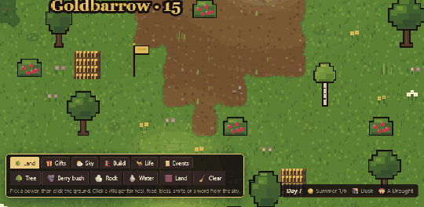
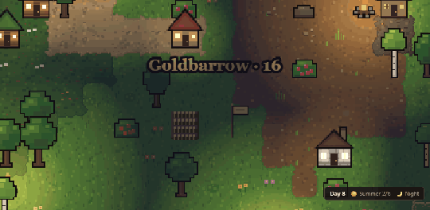

<p align="center">
  
</p>

<h3 align="center">A village that lives, argues, builds and dies on its own, run by a local LLM.</h3>

<p align="center">
  Watch it. Play god over it. Or step into one of its villagers and live there.
</p>

<p align="center">
  
</p>

<p align="center">
  
  
  
  
  
</p>

<p align="center">
  <a href="#run-it"><b>Run it</b></a> &nbsp;·&nbsp;
  <a href="#three-ways-to-play"><b>Three ways to play</b></a> &nbsp;·&nbsp;
  <a href="#the-llm-cant-cheat"><b>The LLM can't cheat</b></a> &nbsp;·&nbsp;
  <a href="docs/REFERENCE.md"><b>Full reference</b></a>
</p>

---

Every villager is a small language model choosing from a list of moves the game engine says are
legal. They gather, farm and build. They trade, fall out, fall in love and have children, who
inherit their looks, their temperament and their strangest beliefs. They remember who wronged them.
Nothing is scripted. Leave a world running and come back to a new village, a feud, or a cult.

> **Elaox:** *"Names are borrowed, so return mine now."*<br>
> **Krasyth:** *"Your name is a dead coin that must be exchanged."*
>
> <sub>Written live by a 2B model. The belief that names are borrowed from the dead spread through
> the whole village by conversation within three minutes.</sub>

## Run it

```powershell
python -m venv .venv
.venv\Scripts\pip install -r orchestrator\requirements.txt
cd orchestrator
..\.venv\Scripts\python -m genesis.server        # then open http://127.0.0.1:8765
```

If [Ollama](https://ollama.com) is installed, the game finds it on its own. Without an LLM, villagers
fall back to a rule-based brain and the game still runs. To carry on where you left off, start it
with `--resume`. There's also a Windows installer: see [Desktop app](docs/REFERENCE.md#desktop-app-build-and-installer).

## Three ways to play

| 👁 Watch | ⚡ God | 🎮 Play |
| :---: | :---: | :---: |
|  |  |  |
| Follow anyone. See what they think, what they carry, who their family is, and hear what they hear. | Paint forests and lakes, raise buildings, call rain, storms or wolves, send a trader or a plague. Speak from the sky, and they answer. | Become a villager. Walk, work, trade, court or fight, and type what you say. They talk back in their own voice. When you die, carry on as your child. |

In **Sandbox** every power is free. In **Deity** mode you earn Faith from prayers and from the
villagers who have seen what you can do.

## A world that keeps going

| A day's work | A village grows | After dark |
| :---: | :---: | :---: |
|  |  |  |

- **Seven kinds of land:** valleys, forests, islands, highlands, desert, river delta and barren plain.
- **Days, nights and seasons.** Windows glow after dark, trees turn and drop their leaves, snow
  settles, and people wrap up in scarves.
- **Weather and danger:** rain, storms, fog and drought, wildfires, fevers, and wolves at night.
- **Villages** with names, land, a shared store, banners, and opinions about their neighbours. A
  village has children only when it has homes to put them in.
- **People who get better at things.** Skills, roles and tools, and families with real family trees.
- **Happenings:** traders, migrants, festivals and omens, plus the news of it all across the top.
- **Saves and replays.** Save any time (Ctrl+S), and scrub back through what just happened.

Everything is drawn in code as pixel art. There are no asset packs.

## The LLM can't cheat

Small models are bad at following rules, so Genesis never asks them to. Each turn the engine lists
what a villager is allowed to do, and a grammar limits the model's reply to exactly those choices:

```text
You are Doian. Your traits are [Hostile, Lazy, Charismatic]. Act accordingly.
health 100 · fullness 97 · energy 82 · wood 0 · home: none
  0  Sleep    1  Walk to the nearest tree    2  Walk to the berry bush
  3  Walk toward Komae    4  Walk toward Thamem    5  Wander
```
```gbnf
root ::= "0" | "1" | "2" | "3" | "4" | "5"
```

Speech works the same way: an option the engine offered, plus at most 14 words. A model can be
rude, paranoid or strange, but it can never make an illegal move. Memories of who helped or hurt
whom (ChromaDB) go into the next prompt, which is where the grudges and alliances come from.
A tiny model makes the hundreds of everyday decisions, and a bigger one writes whatever *you* read.

## Controls

| | |
|---|---|
| Drag, **WASD**, scroll | move and zoom |
| **1** **2** **3** | Watch, God, Play |
| **Space** · **+** **−** | pause · speed |
| **F** · **M** · **H** | follow · minimap · help |
| **,** **.** | step through the replay |
| **Q** **E** · **Shift+1…9** | God mode: power groups · pick a power |
| **Ctrl+S** | save |

## Learn more

The [reference](docs/REFERENCE.md) covers the
[command line](docs/REFERENCE.md#command-line),
[setting up Ollama or llama.cpp](docs/REFERENCE.md#using-a-real-llm-ollama-llamacpp-and-hybrid-cognition),
[how personas and beliefs spread](docs/REFERENCE.md#personas-and-conversations),
[every game rule](docs/REFERENCE.md#game-rules),
[how a tick works](docs/REFERENCE.md#how-a-tick-works),
[adding your own buildings, actions and maps](docs/REFERENCE.md#the-engine-and-adding-content), and
[building the desktop app](docs/REFERENCE.md#desktop-app-build-and-installer).

```
orchestrator/genesis/engine/   the rules: terrain, objects, actions, villages, weather, fire, animals
orchestrator/genesis/          the tick loop, brains, memory, events, god powers, saves, server
web/js/                        the Phaser world, pixel art, side panel, god bar, play mode, sound
```
