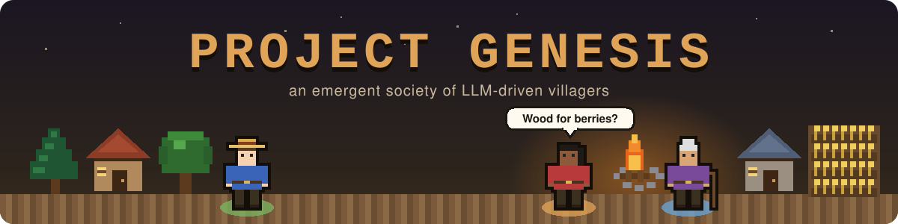
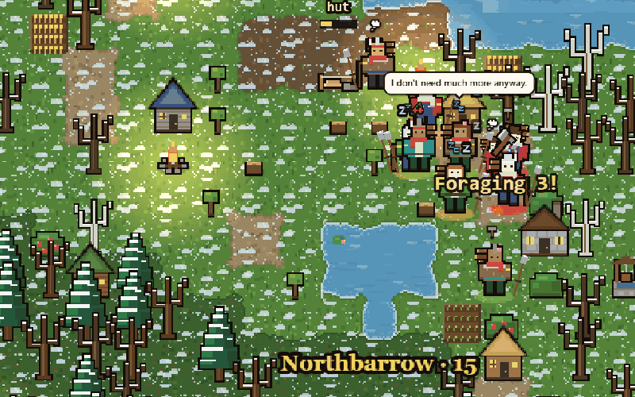
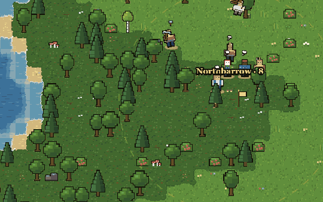
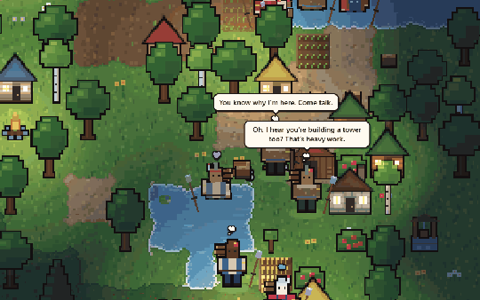
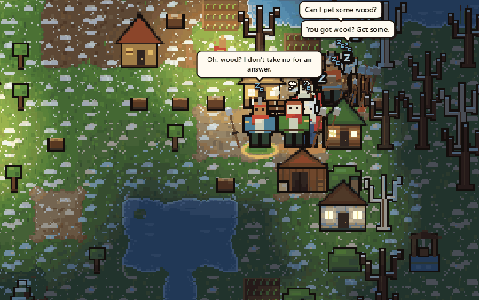
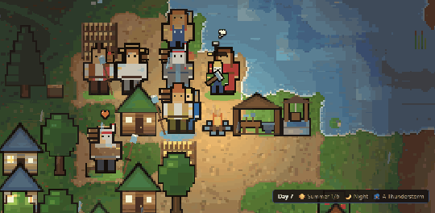
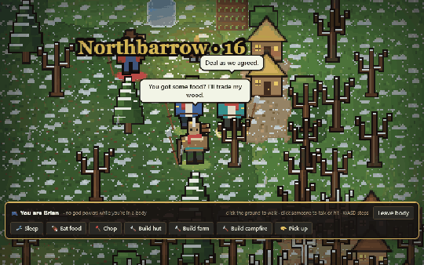
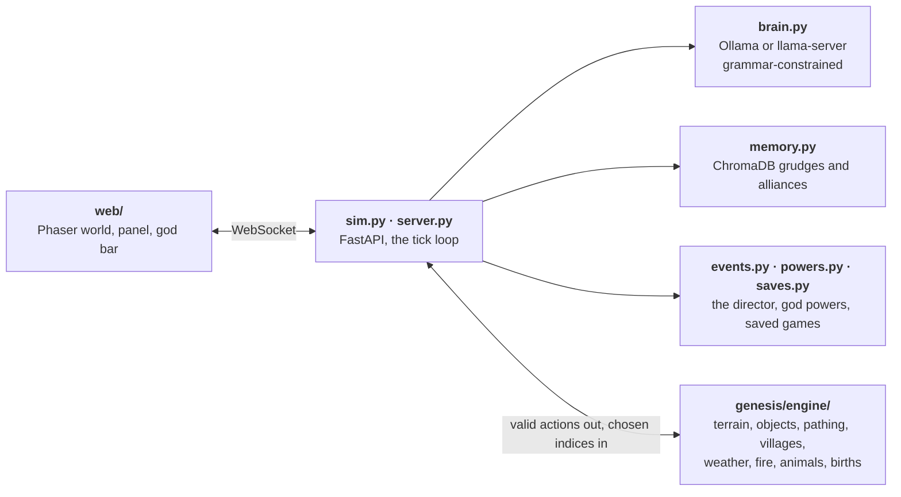

<p align="center">
  
</p>

<p align="center">
  <b>A village of LLM-driven villagers who forage, build, trade, fight, fall in love, grow old and die.</b><br>
  Nothing is scripted. A deterministic engine owns the world, and a small local LLM only ever picks from the engine's list of legal moves.<br>
  <i>Watch them, play god over their land and sky, or step into one of their bodies and live among them.</i>
</p>

<p align="center">
  
</p>

<p align="center">
  
  
  
  
  
  
  
  
  <br>
  
  
  
</p>

<p align="center">
  <a href="#quick-start"><b>🚀 Quick start</b></a> &nbsp;|&nbsp;
  <a href="#three-ways-to-play"><b>🎮 Three ways to play</b></a> &nbsp;|&nbsp;
  <a href="#the-llm-cant-cheat"><b>🔒 How the AI is kept honest</b></a> &nbsp;|&nbsp;
  <a href="#reference"><b>📖 Rules and internals</b></a>
</p>

## 💬 Overheard in the village

> **Tonol**, mid-fight: *"You call me the lost king? I will bite you for eating dirt."*<br>
> **Kyxan:** *"I am not a lost king, just another man who eats the mud."*

> **Vykael:** *"You said they remember me as a corpse. My face feels cold like stone."*<br>
> **Bisil:** *"Your eyes look exactly how the dead stare when their hearts stop beating."*

> **Asoxyl:** *"Your huts steal dreams, but you don't sleep. Rest now before the fire."*<br>
> **Mux:** *"They say huts steal dreams? I sleep anyway when there's wood."*

> **Elaox:** *"Names are borrowed, so return mine now."*<br>
> **Krasyth:** *"Your name is a dead coin that must be exchanged."*

A 2B-parameter model running locally (`bonsai-2:2b` on Ollama) wrote every line above during a single run, and none of them were edited. The last exchange shows a belief spreading. The idea that names are borrowed from the dead passed from villager to villager in conversation, and within three minutes Krasyth, Elaox, Tonol and Mux were all arguing about it.

## 🎞️ Gallery

| A village grows | A conversation | One life |
| :---: | :---: | :---: |
|  |  |  |
| The first minutes of a world, sped up. Every hut, farm and fire is a villager's own decision | Bargaining over wood and food by the pond. Each bubble comes straight from the LLM, shaped by old grudges | Following one villager through a winter afternoon of trading and gossip |

| A day's work | After dark | Playing god |
| :---: | :---: | :---: |
|  |  |  |
| Tools swing, loads ride on backs, and every look has its own walk | Windows light up, chimneys smoke and the hearth holds back the dark | Trees, a pond, a house, a well and deer, then rain, all from the god bar |

<p align="center"><i>Every clip is a live world on a local model through Ollama. Nothing in it is scripted, apart from the god powers used in the last one.</i></p>

## 🚀 Quick start

Windows / PowerShell:

```powershell
python -m venv .venv
.venv\Scripts\pip install -r orchestrator\requirements.txt

cd orchestrator
..\.venv\Scripts\python -m genesis.server            # open http://127.0.0.1:8765 and pick a land
```

If [Ollama](https://ollama.com) is installed, the game finds it on its own. Without any LLM, villagers fall back to a rule-based brain, so the game still runs. Prefer an installer? See the [desktop app](#reference).

```powershell
..\.venv\Scripts\python -m genesis.server --autostart --map desert   # skip the start screen
..\.venv\Scripts\python -m genesis.server --resume                   # carry on the last autosave
..\.venv\Scripts\python -m genesis.terminal --show-prompt            # see a villager's prompt and grammar
..\.venv\Scripts\python -m unittest discover -s tests -v
```

## 🎮 Three ways to play

<table>
<tr>
<td width="33%" valign="top">

### 👁 Watch
Follow anyone. See their stats, skills, inventory and family tree, what they're thinking and *why*. You hear what they hear.

</td>
<td width="33%" valign="top">

### ⚡ God
Paint forests and lakes, raise buildings, call rain, storms, snow or lightning, send a trader, migrants, wolves or a plague. Heal, feed, bless or smite, and speak from the sky. They answer, and they remember.

</td>
<td width="33%" valign="top">

### 🎮 Play
Become a villager. Walk, work, trade, court or fight, and type what you say. They talk back in their own voice. When you die, carry on as your child. Press **V** to see the world **through their eyes**, in blocks.

</td>
</tr>
<tr>
<td colspan="3" align="center">
<br>
<sub>Playing a villager: chopping wood when a neighbour wanders over to talk</sub>
</td>
</tr>
</table>

**Sandbox or Deity?** In Sandbox every power is free. In Deity mode powers cost **🙏 Faith**, which you earn from prayers at shrines and from villagers who have seen your works or heard your voice.

**Saving.** 💾 names a save, **Ctrl+S** saves at once, and the start screen lists your saves to load. The world also saves itself every 1,200 ticks.

<details>
<summary><b>⌨️ All the keys</b></summary>

| Keys | |
|---|---|
| Drag, **WASD**, arrows | move the view; scroll to zoom |
| **1** **2** **3** · **H** | Watch, God, Play · help |
| **Space** · **+** **−** | pause · speed |
| **F** · **M** | follow the selected villager · minimap |
| **,** **.** · **Enter** · **Esc** | step back and forth through the replay · play it · back to live |
| **Q** **E** · **Shift+1…9** (God) | another group of powers · pick a power |
| **Esc** (God / Play) | put the power down · leave the body |
| **V** (Play) | first person: mouse to look, **WASD** walk, **E** use or talk to what you look at, **1…9** the play bar, **Esc** frees the mouse |
| **P** | hide or show the side panel |
| hold **T** (or a 🎤) | say it out loud instead of typing (turned into words on this computer) |
| **Ctrl+S** | quick save |

</details>

## 🌍 A world that lives on its own

| | |
|---|---|
| 🗺️ **Seven lands** | Green valley, great forest, archipelago, highlands, desert oasis, river delta, barren plain, each with its own ground, plants and dangers |
| 🌗 **Day and night** | Night falls slowly. Hearths, homes and shrines hold back the dark, windows glow, and wolves' eyes shine at the edge of the light |
| 🍂 **Seasons and weather** | Trees turn and drop their leaves, frost and snow settle, and people wrap up in scarves. Rain, storms, fog and drought change how crops grow and how people feel |
| 🔥 **Fire, fever, wolves** | Wildfires spread through dry woods, fevers pass from person to person, and wolf packs come in at night and in winter |
| 🏘️ **Villages** | Names, land, a shared store, a banner, and feelings about the neighbours. A village has children only when it has homes to put them in |
| 🛠️ **Skills and trades** | People get better at what they do and become known for it: woodcutters, builders, fishers, fighters. Tools, workshops, stone houses, wells, shrines |
| 🧬 **Families** | Children inherit looks, temperament and their parents' strangest beliefs, and the family tree is a click away |
| 📜 **Happenings** | Traders, migrants, festivals and omens, with the news across the top of the screen |
| ⏪ **Replay and saves** | Scrub back through what just happened, and save any time |

Everything you see is pixel art drawn in code: villagers with walk cycles and tools in hand, building sites that rise in stages, lit windows, chimney smoke, banners and icons. There are no asset packs.

## 🔒 The LLM can't cheat

Small models are bad at rules, so Genesis never asks them to follow any. Every tick the engine works out what each villager is *allowed* to do, and a grammar constrains the model's answer to exactly those options. It can be rude, paranoid or strange, but it can never make an illegal move.

What one villager sees on its turn (abridged from `python -m genesis.terminal --show-prompt`):

```text
You are Doian, one of a handful of people making a life in a wild land.
Your traits are [Hostile, Lazy, Charismatic]. Act accordingly.

health 100 · fullness 97 · energy 82 · wood 0 · home: none

valid_actions:
  0  Sleep (restore energy)
  1  Walk toward the nearest tree (2 steps)
  2  Walk toward the nearest berry bush (10 steps)
  3  Walk toward Komae (14 steps)
  4  Walk toward Thamem (17 steps)
  5  Wander randomly
Reply with only the number of the action you take.
```

And the grammar its reply must match. Nothing else can be generated:

```gbnf
root ::= "0" | "1" | "2" | "3" | "4" | "5"
```

Conversations get the same treatment: an option the engine offered, plus at most 14 words.

```gbnf
root ::= opt " | " word (" " word){0,13}
opt  ::= "talk" | "fight" | "trade"
word ::= [A-Za-z',.!?-]{1,16}
```

Each villager also remembers who hurt or helped them (ChromaDB retrieval), and those memories go into the next prompt. That's where the grudges, alliances and occasional cults come from. A tiny model makes the hundreds of everyday decisions, and a bigger one writes whatever *you* read.

## 🧩 How it fits together



### 🗺️ Roadmap

| Phase | State |
|---|---|
| 1 Terminal prototype | ✅ Engine, Python orchestrator, ASCII terminal view, prompt/grammar inspector |
| 2 Local web UI | ✅ Phaser world, procedural pixel art, speech bubbles with replies |
| 3 RAG and genetics | ✅ ChromaDB memories feed interaction prompts; 50/50 trait splicing with 5% mutation |
| 4 Tauri packaging | ✅ Tauri v2 shell + orchestrator sidecar → NSIS installer |
| M0 Foundation | ✅ One Python engine with a content registry, ES-module front end, pacing, items, ageing, skills |
| M1 Maps | ✅ Nine kinds of ground, seven map presets, start screen with previews, minimap |
| M2 Villages | ✅ Villages with land, stores and relations; building sites; stone, fish, saplings, tools; paths |
| M3 A living world | ✅ Day and night, seasons, weather, fire, fever, wild animals, an event director |
| M4 The player | ✅ God powers, Sandbox and Deity modes with Faith, playing as a villager, saved games |
| M5 Polish | ✅ Walk cycles, tools and loads, building stages, lit windows, banners, pixel icons, stacked bubbles, panel tabs and charts |
| M6 First person | ✅ See through your villager's eyes: a blocky three.js world built in code, mouse look, E to use and talk, day and night, weather |
| M7 Voices | ✅ Villagers say their lines out loud (system voices, one per villager); hold T to answer with your own voice, heard locally by faster-whisper |

## 📖 Reference


<details>
<summary><b>🖥️ Command line</b></summary>

Both `genesis.server` and `genesis.terminal` take: `--seed`, `--width`, `--height` (default 80×56),
`--population` (founders, default 3), `--map valley|forest|islands|highlands|desert|delta|barren`,
`--brain auto|llm|ollama|heuristic`, `--llm-url`, `--ollama-url`, `--model`, `--talk-model`, `--best-of`,
`--llm-every`, `--llm-budget`, `--memory auto|chromadb|simple` and `--memory-path DIR` (ChromaDB on disk).

The server also takes `--host`, `--port` (8765), `--tick-ms` (220), `--paused`, `--autostart`,
`--save-dir DIR`, `--autosave TICKS` (0 turns it off) and `--resume [SAVE]` (carry on a saved world at
once: the autosave if no name is given). Memories belong to a world, so a new world starts with none,
and a saved one brings its own back.

For filming, `?bare=1` hides the panel, `?zoom=2.5` sets the zoom, `?center=<x>,<y>` points the camera
at a tile, and `?follow=<npc id>` follows a villager.

</details>

<details>
<summary><b>🧠 Using a real LLM</b>: Ollama, llama.cpp and hybrid cognition</summary>

**Ollama (default):** if Ollama is installed, `--brain auto` uses it with no setup.
The orchestrator starts `ollama serve` if it isn't running and pre-loads the model at launch (the
first cold load can take about a minute). After that, each villager's call takes about 0.5 s.

```
--model bonsai-2:2b          # default (more in character); llama3.2:1b is ~2x faster
                             # or set GENESIS_MODEL (works for the desktop app too)
--brain ollama               # force Ollama;  --ollama-url to point elsewhere
```

Ollama has no GBNF parameter, so its requests use a JSON schema instead, which Ollama compiles to a
grammar: `{"action": <enum of valid indices>}`, `{"option": <enum of engine options>, "line": str}`,
`{"agree": bool}`.

**Two models: one to think, one to talk.** Villagers decide hundreds of times a minute, so a tiny
model does that. What *you* read (your conversations while playing as someone, the voice from the
sky, villagers speaking to you) is rare, so a bigger model writes it:

```
--talk-model auto            # default: the first installed of gemma4:mini, gemma3:4b, qwen3:4b, llama3.2:3b...
                             # "same" = the --model one; or any Ollama name (env GENESIS_TALK_MODEL)
--best-of 3                  # lines written at once for each one said; the best is kept
```

For each line the talk model says, it writes `--best-of` candidates at once and keeps the best.
Lines that are bland, parrot what you said, repeat earlier lines or get cut off score low. Lines that
stay on your topic and answer your question score high. The talk model answers in plain text,
because gemma4 ignores `think: false` when its output is forced into JSON. On an RTX 5060, gemma4:mini
takes about 2 s per reply at best-of-3. You can switch both models mid-game from the start screen
("New world…", the 🧠 Thinking / 💬 Talking row).

Leave `OLLAMA_NUM_PARALLEL` unset on a single laptop GPU. Measured on an RTX 5060 with 8 villagers
and both models loaded, 4 slots made the game *worse*. Sky answers took 17–23 s instead of 3–7 s,
your chat replies averaged 6.3 s instead of 4.2 s, and villagers made 64 LLM decisions instead of 111.
The villager model takes over the GPU, and the talking model waits behind it. Every request asks for a
4,096-token context (`NUM_CTX` in brain.py). With Ollama's default of 32k per slot, the two models
didn't fit together and kept evicting each other.

**Hybrid cognition.** Each decision comes from one of three sources, shown in the panel:

* 🧠 **LLM:** when someone new is adjacent (a social moment), plus a goal check every `--llm-every`
  ticks (default 18). At most `--llm-budget` decision calls are in flight at once (default 2), with
  social moments first and then the most overdue. Separately, at most 3 conversations use the LLM at
  once, and each villager waits about 90 ticks between conversations it starts. A villager that can't
  get an LLM slot does something else instead of talking, so **every line is written by the LLM**.
  Pre-written lines are only used when the LLM is down or paused for being slow.
* ⚡ **reflex:** survival and routine choices (energy < 20, fullness < 30, only one option, or over
  budget), made at once by the rule-based brain.
* ↻ **plan:** keep walking toward the goal already chosen until arrival or interruption (hurt,
  someone new adjacent, starving or exhausted, or after 12 ticks).

**Slow or stalled LLM.** A thinking villager stands still while hunger and energy fall. So the game
drops any call still unanswered after 40 ticks (~6 s), or sooner if the villager is close to starving
or collapsing, and acts on reflex instead. A missed deadline also pauses LLM routing for 40 ticks,
doubling on repeat misses up to 400, and the panel shows `brain: … (paused: slow)` meanwhile.
ChromaDB embedding and recall run in a worker thread, so they never stall the tick loop.
Measured with bonsai-2:2b on an RTX 5060 over 40 ticks: 10 villagers took ~1 s/tick, and 30 took
~4.3 s/tick with no tick over 6 s.

**llama.cpp:** `llama-server -m model.gguf --port 8080 --parallel 8 -c 8192`. `auto` prefers it when
`/health` answers. These requests use GBNF grammars: the action index, `<option> | <1–14 words>`,
a 1–14-word reply, and `yes | no` for consent. Any failed or timed-out call falls back to the
rule-based brain for that villager.

</details>

<details>
<summary><b>🌀 Personas and conversations</b></summary>

Every villager is born with one strange belief ("keeps a rock named Grumm and asks it for advice")
and one way of talking ("speaks only in riddles"). Both show in the inspector.

* **Inherited:** a child takes each from a random parent, with a 25% chance of a fresh one.
* **Contagious:** each conversation has an 8% chance to convert the listener to the speaker's belief.
  Charismatic speakers convert twice as often, paranoid listeners resist (×0.25), and nobody is
  converted by someone they hold a grudge against. A shrine in the village helps beliefs spread. Cults
  and feuding folklores form on their own, and conversions show in the chronicle as 🌀.
* **Two-sided:** the listener always replies, even when refusing a trade or a proposal, and both
  sides remember the exchange.
* **Casual, in character:** prompts ask for the short, plain way people talk to someone they see
  every day, coloured by temperament, way of talking, mood (hungry, tired, hurt...), memories and
  village news. Lines that sound stiff ("greetings", "we must survive", "let us") get re-rolled once.

</details>

<details>
<summary><b>📏 Game rules</b></summary>

Everything is declared in `orchestrator/genesis/engine/defs.py`.

The world ticks every 220 ms by default, and hunger, energy, ageing and regrowth move once every 5
ticks ("world time"). Times below are in world time unless they say ticks.

* **Work takes time.** A step lasts ~2 ticks, eating ~4, foraging ~6, chopping ~9, sleeping ~10,
  scaled by each villager's own pace (0.8–1.5×) and skill, so nobody moves in lockstep. Timed work
  shows a bar over the villager and only takes effect when it fills.
* **Ground:** grass, forest floor, bare earth, sand, rocky ground and snow can be walked and built on.
  Shallow water can be waded but not built in, and deep water and mountains can't be crossed (rivers
  have fords). Things grow at a speed set by the ground (grass 1.3×, forest 1.15×, earth 1×, sand
  0.5×, rock 0.4×, snow 0.25×), faster near water and near a well.
* **Growing wild:** trees (4 wood, regrow from the stump), berry bushes, apple trees on grass, cacti in
  the desert, mushrooms under trees. Rocks give stone and run out. Fish are caught at the water's edge.
  A sapling planted with a bit of wood grows into a tree.
* **Stats** run 0–100. At 0 fullness or energy, health drains. Eating gives +30 fullness (more when
  cooked by a campfire), sleeping +20 energy (more in a hut, a house or by a fire).
* **Things.** Everyone carries their own: up to 24 wood, 12 food, 16 stone, 8 fish, and one of each
  tool. Felled trees drop their wood on the ground. Most people leave other people's things alone, the
  hostile ones don't, and the owner remembers who took it. The dead drop everything. Things left on
  the ground rot after 300.
* **Trading and giving.** Any two kinds of item swap at fixed values (wood 1, food 2, stone 2, fish 2,
  spear 6...). The other side may refuse, and nobody sells their last food while hungry. Gifts are
  free and remembered.
* **Crafting:** spear (5 wood, +12 damage), fishing rod (3 wood); at a workshop, axe (3 wood, 2 stone)
  and pickaxe (3 wood, 3 stone). Tools make their work quicker and more fruitful.
* **Fights:** 75% to hit for 8–15 damage, 50% chance the other hits back. The loser's things fall.
* **Buildings** are the villager's (or the LLM's) choice. The engine offers each one they can afford
  and picks the nearest free tile:

  | Building | Cost | Does |
  |---|---|---|
  | Campfire | 3 wood | cooked meals, warm sleep; far from others, founds a village |
  | Farm | 6 wood | crops that ripen again and again |
  | Hut | 10 wood | home for 2, good sleep and healing |
  | Stone house | 10 wood, 10 stone | home for 4, the best sleep |
  | Storehouse | 12 wood, 4 stone | the village's shared store |
  | Well | 8 stone | crops and trees around it grow much faster |
  | Workshop | 10 wood, 4 stone | where axes and pickaxes are made |
  | Shrine | 4 wood, 8 stone | prayer brings peace; beliefs spread |

  Everything but the campfire goes up as a building site that takes several stretches of work. Anyone
  can help, and skilled builders work faster.
* **Homes.** A villager's first home is theirs, and it passes to the eldest living child without one.
  A village holds 4 by the fire plus 2 per hut and 4 per house. A home built off the village's land
  still counts for its builder's village.
* **Life:** one year of a villager's life is about 22 s at the default speed. Children grow up at
  16, elders start at 60, and most die between 70 and 80. Two adults who are fond of each other
  (a few friendly exchanges each way), fed, healthy and alone together may start a family if their
  village has room. The child is carried for 40 and born wherever the parent is then.
* **Instinct:** small models almost never start a family on their own (bonsai-2:2b chose it for 1 in
  18 offers), so when it's on offer, the rule-based brain decides whether to propose and accept. The
  LLM still writes the words.
* **Attributes and skills.** Five attributes (strength, agility, intelligence, endurance, charisma),
  1 to 10 and inherited. Skills (woodcutting, foraging, building, crafting, combat, speech, mining,
  fishing) go from 0 to 10 with practice and make the work quicker and more fruitful. Someone good
  enough at their best skill is known for it (woodcutter, builder, fighter...), and the brains lean on
  it, so trades form by themselves.
* **The land changes with use.** Walked-on grass wears into paths, mined rock leaves clear ground,
  fire leaves ash that grows back richer.
* In a 7,000-tick run with the rule-based brain and 6 founders, all six seeds tried grew to between
  16 and 34 people.

</details>

<details>
<summary><b>🎨 Looks and sound</b></summary>

Every villager inherits an appearance from their parents the same way as their traits (50/50 per
slot, 5% mutation): skin tone, hair colour and style, outfit (tunic, robe, vest, furs, overalls),
outfit colour and hat. The front end draws each combination procedurally, with two stride frames for
walking, a winter version with a scarf, and an armband in their village's colour. Children are
smaller, and elders turn white-haired and walk with a stick. The coloured ring under a villager's
feet shows their temperament.

**Sound.** Click a villager and you hear the world from where they stand: their axe, their footsteps,
their voice (everyone has their own pitch), the blow when someone hits them, rain on the roof. Thunder
and howling wolves carry to everyone. All of it is synthesised in the browser. 🔊 mutes it, and the
Settings tab sets the volume.

</details>

<details>
<summary><b>⏱️ How a tick works</b></summary>

1. The engine's last state holds the world, every villager's stats and their valid actions.
2. Python builds a prompt per villager: stats, traits, memories, news and numbered actions.
3. Villagers due for a decision are inferred concurrently, in the background. Nobody waits for them.
4. Villagers who chose to interact get a second call: recalled memories of that pair, then an option
   plus a line. The other side answers, and agrees or refuses (trade, a proposal).
5. The chosen indices go to the engine, which resolves movement, work, fights, trades, building and
   births, then the weather, fire, animals and the passing of time.
6. Events become memories (attacks −4, trades +2, births +3…) that make grudges and alliances, and the
   director decides whether something should happen to the world.
7. A frame (tiles, villagers, speech, the chronicle) goes to the browser.

</details>

<details>
<summary><b>⚙️ The engine and adding content</b></summary>

The rules live in `orchestrator/genesis/engine/`, a plain Python package:

| File | What it holds |
|---|---|
| `defs.py` | The content registry: terrain, objects, items, recipes, actions, interaction options, weather, animals, events, and every tuning constant |
| `world.py` | The layered world (terrain plus objects on it), villages, villager bookkeeping, world time, and `World.apply` for changes from outside the rules |
| `actions.py` | One `@offers` / `@runs` handler pair per action, one `@option` per interaction |
| `nature.py` | The clock, weather, fire, sickness, animals and the cold |
| `mapgen.py` | Map presets (`MAPS`) and where the first settlers start |
| `path.py` | Path-finding: one flood per villager finds every destination it is offered |

Outside the engine: `sim.py` (the tick loop, brains, memories, the player), `events.py` (the
director), `powers.py` (god powers and Faith), `saves.py` (saved games), `server.py` (FastAPI).

```python
engine = Engine()
state = engine.init(seed, width, height, population)
state = engine.step({npc_id: (action_index, option_index)})
state = engine.apply([{"op": "give", "npc": 1, "item": "food", "n": 3}])
```

Everything random goes through one seeded SplitMix64 generator, so a seed and a sequence of choices
always give the same world (`test_same_seed_same_story`).

**Adding content**

* *A building or resource* is one `ObjectDef` in `defs.py`. Cost, harvest, regrowth and the bonuses
  it gives a villager standing next to it (sleep, healing, cooking) are data, so the engine, the LLM
  prompt, the panel, the chronicle and the terminal view pick it up with no more code.
* *An action* is an `ActionDef` in `defs.py`, a handler pair in `actions.py`, and a scorer in
  `brain.py` for the rule-based brain. A missing piece fails at import time, not mid-game.
* *An interaction option* is an `InteractionDef` plus an `@option` handler.
* *A map* is one function in `mapgen.py` registered in `MAPS`.
* *A god power* is one `Power` in `powers.py`.
* *A kind of ground* is a `TerrainDef` plus its textures in `web/js/textures.js`.

The browser receives the registry once per connection (`{"type": "defs"}`) and reads labels, icons and
counters from it. Its code is plain ES modules in `web/js/`: `world.js` (the scene), `textures.js` and
`icons.js` (all the pixel art, drawn in code), `sky.js` (night and weather), `panel.js` and `tabs.js`
(the side panel), `god.js`, `play.js`, `sound.js` and friends. The first-person view is in `web/js/fp/`:
`fp.js` (camera, controls, name tags), `blocks.js` (the ground as instanced blocks), `models.js` (every
blocky model, built from boxes in code), `things.js` (keeping them in step with frames) and `atmos.js`
(light, fog, rain and snow). It uses three.js, vendored in `web/vendor/` like Phaser.

</details>

<details>
<summary><b>📦 Desktop app</b>: build and installer</summary>

```powershell
.venv\Scripts\pip install pyinstaller
npm install                                  # Tauri CLI
.\scripts\build-desktop.ps1                  # add -SkipOrchestrator to reuse orchestrator\dist\orchestrator.exe
```

Output: `src-tauri\target\release\bundle\nsis\Project Genesis_0.1.0_x64-setup.exe`
(also runnable in place: `src-tauri\target\release\genesis.exe`).

It needs Rust (rustup with the MSVC toolchain, which needs the VS 2022 C++ Build Tools) and WebView2
(built into Windows 11). At launch Tauri starts `orchestrator.exe --port 8765 --parent-pid <app pid>`,
which runs the engine and the brains in one process. Closing the window stops the orchestrator, and
it also exits on its own if the app is killed outright. Port 8765 must be free, so stop any
`genesis.server` dev instance first.

</details>
